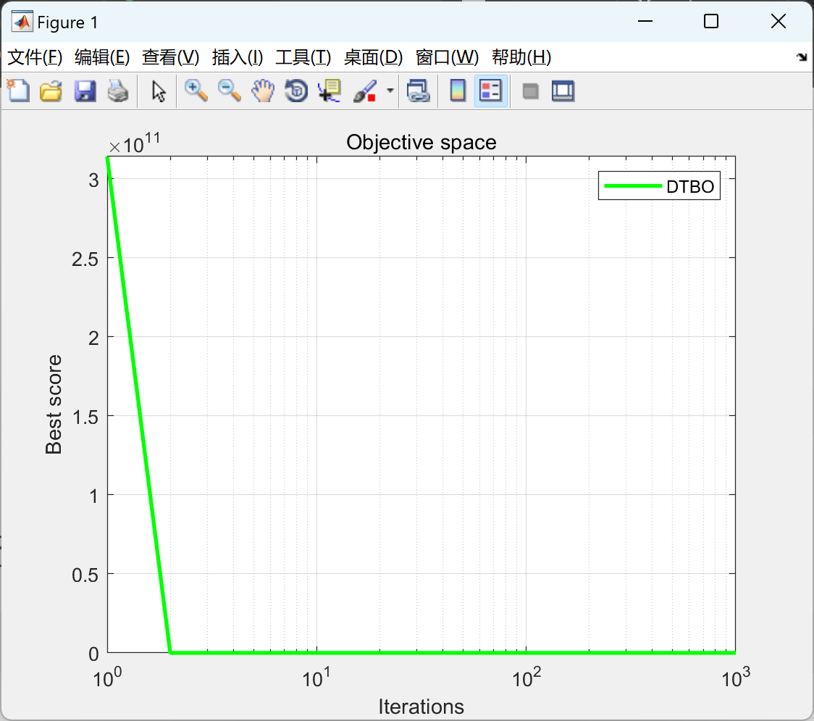

# Matlab|Driving Training Optimization Algorithm (DTBO)

This article introduces a new stochastic optimization algorithm, called Driving Training Optimization (DTBO), which mimics the activities of human driving training. The basic inspiration behind the design of DTBO comes from the process of learning to drive in a driving school and the training of driving instructors.
\n        \n      \n\n\n\n\n\n\n\n%%% Designed and Developed by Mohammad Dehghani %%%\n\n\n\n\nfunction[Best_score,Best_pos,DTBO_curve]=DTBO(SearchAgents,Max_iterations,lowerbound,upperbound,dimension,fitness)\n\n\nlowerbound=ones(1,dimension).*(lowerbound);                              % Lower limit for variables\nupperbound=ones(1,dimension).*(upperbound);                              % Upper limit for variables\n\n\n%%\nfor i=1:dimension\n    X(:,i) = lowerbound(i)+rand(SearchAgents,1).*(upperbound(i) - lowerbound(i));                          % Initial population\nend\n\n\nfor i =1:SearchAgents\n    L=X(i,:);\n    fit(i)=fitness(L);\nend\n%%\n\n\nfor t=1:Max_iterations\n    %% update the best member\n    [best , blocation]=min(fit);\n    if t==1\n        Xbest=X(blocation,:);                                           % Optimal location\n        fbest=best;                                           % The optimization objective function\n    elseif best<fbest\n        fbest=best;\n        Xbest=X(blocation,:);\n    end\n    \n    %%\n    XF=[X fit'];\n    XFsort=sortrows(XF,dimension+1);\n    X=XFsort(:,1:dimension);\n    fit=(  XFsort(:,1+dimension) )';\n    N_DI=1+round(0.2*SearchAgents*(1-t/Max_iterations));\n    \n    DI=XFsort(1:N_DI,1:dimension);\n    F_DI=(  XFsort(1:N_DI,1+dimension)  )';\n    \n    %% update DTBO population\n    \n    for i=1:SearchAgents\n        \n        %% Phase 1: training by the driving instructor (exploration)\n        k_i=randperm(N_DI,1);\n        DI_ki=DI(k_i);\n        F_DI_ki=F_DI(k_i);\n        I=round(1+rand(1,1));\n        if F_DI_ki< fit (i)\n            X_P1=X(i,:)+rand(1,1) .* (DI_ki-I.*X(i,:)); % Eq. (5)\n        else\n            X_P1=X(i,:)+rand(1,1) .* (1.*X(i,:)-I.*DI_ki); % Eq. (5)\n        end\n        X_P1= max(X_P1,lowerbound);X_P1 = min(X_P1,upperbound);\n        \n        % Update X_i based on Eq(6)\n        F_P1 = fitness(X_P1);\n        if F_P1 <= fit (i)\n            X(i,:) = X_P1;\n            fit (i)=F_P1;\n        end\n        \n        %% END Phase 1: training by the driving instructor (exploration)\n        \n        %% Phase 2: learner driver patterning from instructor skills (exploration)\n        PIndex=0.01+0.9*(1-t/Max_iterations);\n        X_P2=(PIndex).* X(i,:)+(1-PIndex) .* (Xbest); % Eq. (7)\n        X_P2= max(X_P2,lowerbound);X_P2 = min(X_P2,upperbound);\n        \n        % Update X_i based on Eq(8)\n        F_P2 = fitness(X_P2);\n        if F_P2 <= fit (i)\n            X(i,:) = X_P2;\n            fit (i)=F_P2;\n        end\n        %% END Phase 2: learner driver patterning from instructor skills (exploration)\n        \n        %% Phase 3: personal practice (exploitation)\n        R=0.05;\n        X_P3= X(i,:)+ (1-2*rand(1,dimension))*R*(1-t/Max_iterations).*X(i,:);% Eq.(9)\n        X_P3= max(X_P3,lowerbound);X_P3 = min(X_P3,upperbound);\n        \n        % Update X_i based on Eq(10)\n        F_P3 = fitness(X_P3);\n        if F_P3 <= fit (i)\n            X(i,:) = X_P3;\n            fit (i)=F_P3;\n        end\n        %% END Phase 3: personal practice (exploitation)\n        \n    end% END for i=1:SearchAgents\n    \n    best_so_far(t)=fbest;\n    \nend% END for t=1:Max_iterations\nBest_score=fbest;\nBest_pos=Xbest;\nDTBO_curve=best_so_far;\nend\n\n\n  

## Images

<!-- PAYMENT_BLOCK -->

## Get this dataset

- Payment link (Stripe): [Buy now](https://buy.stripe.com/3cs8yP7sY87d0vu9AB)
- Payment QR code: 

<!-- /PAYMENT_BLOCK -->
